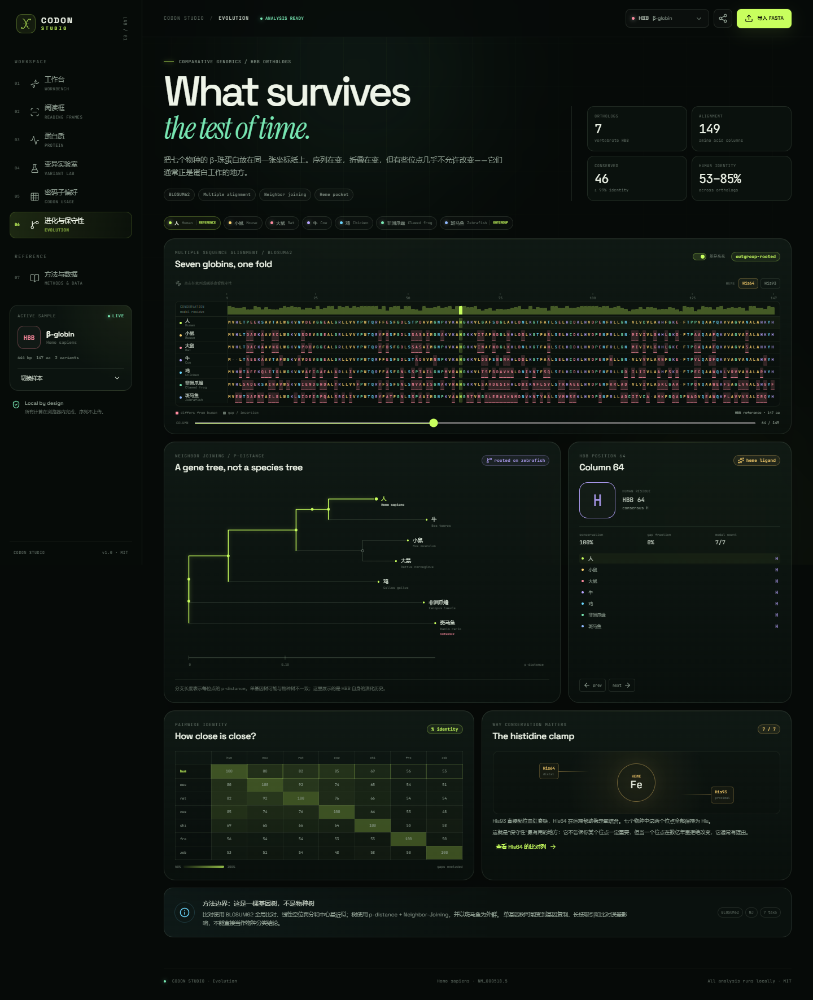
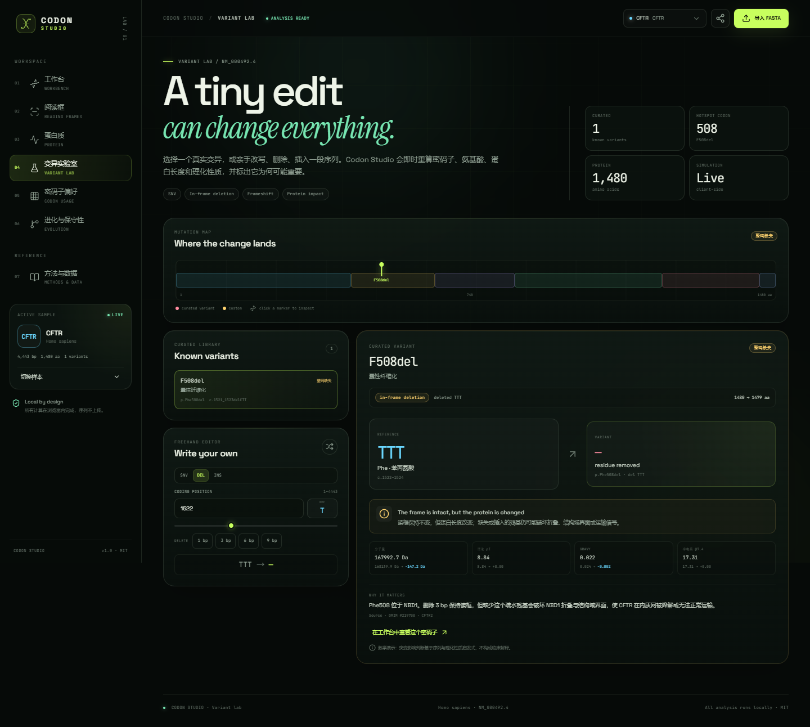

<div align="center">

# CODON / STUDIO

### 把生命读成代码。

一个交互式中心法则与比较基因组学实验台：真实基因序列、六阅读框 ORF、蛋白质化学、序列进化与变异编辑。
**React 19 · TypeScript · Vite · 纯前端 · MIT**

[Live demo](https://tynyan.github.io/codon-studio/) · [Source](https://github.com/Tynyan/codon-studio)


</div>

---

## 这是什么？

**Codon Studio（密码子工坊）** 把「DNA → mRNA → 蛋白质」做成一台可以上手操作的仪器，并把分析继续推进到**跨物种比较**和**序列编辑**。

你可以：

- 在真实的 **HBB、INS、TP53、CFTR、SARS-CoV-2 Spike** 编码序列之间切换；
- 沿序列移动，实时看到密码子、氨基酸与肽链；
- 打开 **六阅读框**，比较同一段 DNA 在不同起点下读出的不同蛋白；
- 点击任意碱基做 **定点突变**，立刻判断同义 / 错义 / 无义，并观察蛋白理化性质的变化；
- 在 **Evolution** 视图中比较 7 个物种的 HBB 同源蛋白，查看多序列比对、保守性轨迹和 Neighbor-Joining 系统发育树；
- 在 **Variant Lab** 中编辑替换、缺失、插入，区分 in-frame 与 frameshift，并分析真实的 **CFTR F508del**；
- 查看密码子使用偏性、GC3、CAI、稀有密码子与氨基酸组成；
- 导入自己的 FASTA，在浏览器本地完成全部分析。

所有计算都在客户端完成，**序列不会上传到服务器**。


## 三步上手

1. **选一个真实基因**：右上角基因按钮打开样本库，或打开「导入 FASTA」粘贴自己的 CDS。
2. **点一个碱基**：在中央序列轨道上选择任意碱基，右侧会列出替换选项；点击后立即看到密码子、氨基酸和 `ΔGRAVY`。
3. **换一个视角**：左侧进入「阅读框 / 蛋白质 / 变异实验室 / 密码子偏好 / 进化与保守性」，所有视图共享当前样本。

小提示：`Variant lab` 里有 HbS、p53 R175H、Spike D614G、CFTR F508del 等真实变异；`Evolution` 里的 His64 / His93 是血红蛋白 heme 口袋的两个关键组氨酸。

## 为什么适合作为课程项目

| 课程概念 | 项目中的对应实现 |
| --- | --- |
| 中心法则 | DNA 编码链 → mRNA → 蛋白质的同步可视化 |
| 遗传密码 | 标准遗传密码表、64 个密码子、密码子轮盘 |
| 开放阅读框 | 三正向 + 三反向的六阅读框 ORF 扫描 |
| 序列特征 | GC 含量、GC3、碱基组成、GC 沿序列分布 |
| 蛋白质性质 | 分子量、理论 pI、GRAVY、净电荷、氨基酸组成 |
| 密码子偏好 | 人类参考密码子频率、CAI、稀有密码子 |
| 序列比较 | BLOSUM62 全局比对、中心星多序列比对、保守性轨迹 |
| 系统发育 | p-distance + Neighbor-Joining，斑马鱼外群定根 |
| 变异注释 | 同义 / 错义 / 无义 / 终止丢失；替换 / 缺失 / 插入 |
| 软件工程 | TypeScript strict、纯函数算法层、29 个单元测试、零 lint warning、响应式与可访问性 |

### 五个真实基因 + 七个 HBB 同源蛋白

- **HBB**：镰状细胞贫血 HbS、HbC
- **TP53**：R175H、R248Q
- **CFTR**：F508del（3 bp 整码缺失）
- **SARS-CoV-2 Spike**：D614G、N501Y
- **INS**：胰岛素前体
- **HBB orthologs**：人、小鼠、大鼠、牛、鸡、非洲爪蟾、斑马鱼

## 界面

### 进化与保守性
7 个物种的 HBB 蛋白比对、保守性轨迹、identity matrix 与 outgroup-rooted NJ 树。



### CFTR F508del
一个 3 bp 缺失如何保持读框，却让蛋白在到达细胞膜前被质量控制拦截。



### 六阅读框
同一段 3,822 bp 的 Spike CDS，正反链共 6 个阅读框，ORF 按长度排序。


### 密码子轮盘
64 个密码子按氨基酸分组，扇区透明度表示人类使用频率，内圈荧光弧表示本基因是否使用。


### 蛋白质
结构域、残基级序列、Kyte–Doolittle 疏水性曲线与氨基酸组成。


### 方法与数据
公式、数据来源、算法边界全部写在应用里，而不是只藏在 README。


### 手机端


## 快速开始

```bash
# 1. 安装依赖
npm install

# 2. 启动开发服务器
npm run dev
# → http://127.0.0.1:5173

# 3. 生产构建
npm run build

# 4. 本地预览构建结果
npm run preview
```

要求：**Node.js ≥ 22**（开发时使用 Node 24）。

### 测试与质量检查

```bash
npm test        # 29 个算法单元测试
npm run lint    # Oxlint，0 warning
npm run build   # TypeScript strict + Vite production build
```

## 部署

项目已经部署在 **GitHub Pages**：

**https://tynyan.github.io/codon-studio/**

仓库包含 [deploy.yml](.github/workflows/deploy.yml)，push 到 `main` 后会执行测试、构建并发布。Vite 使用 `base: "./"`，因此可部署在任意项目子路径。

## 项目结构

```text
.
├── scripts/
│   ├── fetch-data.py        # 从 NCBI / Kazusa 重新生成所有数据
│   └── capture.mjs          # 用 Edge/Chrome 生成 docs 截图
├── src/
│   ├── components/
│   │   ├── SequenceStage.tsx
│   │   ├── EvolutionView.tsx
│   │   ├── AlignmentViewer.tsx
│   │   ├── TreeView.tsx
│   │   ├── VariantsView.tsx
│   │   └── ...
│   ├── data/
│   │   ├── catalog.ts       # 基因元数据、结构域、真实变异
│   │   ├── sequences.json   # 5 个基因的 RefSeq / GenBank CDS
│   │   ├── orthologs.json   # 7 个 HBB 同源蛋白
│   │   └── codonUsage.json  # Kazusa 人类密码子频率
│   ├── lib/
│   │   ├── genetics.ts      # 翻译、ORF、突变、indel、理化性质
│   │   ├── evolution.ts     # 比对、保守性、距离矩阵、NJ
│   │   ├── analysis.ts      # 派生分析与变异解释
│   │   └── *.test.ts        # Vitest 单元测试
│   ├── App.tsx
│   └── styles.css
├── docs/                    # README 截图
└── .github/workflows/deploy.yml
```

算法层 `src/lib/` 不依赖 React；组件只负责呈现。这样序列操作、比对和建树都可以单独测试。

## 算法说明

### 翻译与 ORF

- 使用 NCBI 标准遗传密码（table 1），按 3 bp 读取，遇到 `TAA / TAG / TGA` 终止。
- 六阅读框：正向 3 个相位 + 反向互补链 3 个相位。
- 对每个 `ATG` 向后扫描同框终止密码子；默认展示 ≥20 aa 的 ORF。
- 反向 ORF 的坐标会映射回正向参考序列。

### 多序列比对与进化树

- 以人 HBB 为中心序列，对每个同源蛋白做 **Needleman–Wunsch 全局比对**。
- 打分使用 **BLOSUM62**，空位采用线性罚分（-6）。
- 把成对比对投影到中心序列坐标，得到中心星（center-star）多序列比对。
- 每个比对列计算 modal residue、保守性和 gap fraction。
- 两两 identity 转为 p-distance，使用 **Neighbor-Joining** 建树。
- 使用斑马鱼作为外群定根，树上的分支长度是 p-distance。
- 这是一棵**单基因树**，不是物种树；中心星和 p-distance 都是教学友好的近似方法。

### 蛋白质性质

- **分子量**：`Σ residue mass − 18.015 × (n − 1)`，使用平均残基质量。
- **理论 pI**：Henderson–Hasselbalch 净电荷公式 + pH 0–14 二分搜索。
- **GRAVY**：Kyte–Doolittle 疏水性标度的全蛋白平均；曲线使用 9 aa 滑动窗口。
- **组成**：20 种标准氨基酸计数，终止密码子不计入长度。

### 密码子偏好

- **CAI**：`exp(mean(ln(w)))`，其中 `w = f(codon) / max f(synonymous codons)`。
- 参考集为 Kazusa 人类密码子使用表（93,487 CDS / 40,662,582 codons）。
- **GC3**：编码序列第三位碱基的 GC 比例。
- **稀有密码子**：人类使用比例 `< 0.15` 的密码子（仅用于可视化，不是硬性生物学阈值）。

### 变异与 indel

变异引擎把编辑统一表示为：

```ts
type SequenceEdit =
  | { type: "substitution"; position: number; alt: string }
  | { type: "deletion"; position: number; length: number; deleted?: string }
  | { type: "insertion"; position: number; inserted: string };
```

- 替换：保持长度，按密码子翻译结果分类为同义 / 错义 / 无义 / stop-loss。
- 缺失 / 插入：重新翻译整条 CDS。
  - 长度变化是 3 的倍数 → **in-frame deletion / insertion**
  - 否则 → **frameshift**
- 同时计算蛋白长度、质量、pI、GRAVY 与净电荷的变化。

CFTR F508del 采用 `c.1521_1523delCTT` 的 HGVS 记录（界面以 codon 508 的 `TTT` 作为展示锚点），结果是 p.Phe508del：读框不变，但蛋白从 1480 aa 变为 1479 aa。

## 数据来源

| 基因 / 数据 | Accession | 区域 | 来源 |
| --- | --- | --- | --- |
| HBB | `NM_000518.5` | CDS 51..494 | NCBI RefSeq |
| INS | `NM_000207.3` | CDS 60..392 | NCBI RefSeq |
| TP53 | `NM_000546.6` | CDS 143..1324 | NCBI RefSeq |
| CFTR | `NM_000492.4` | CDS 71..4513 | NCBI RefSeq |
| SARS-CoV-2 S | `NC_045512.2` | S CDS 21,563..25,384 | NCBI GenBank |
| HBB orthologs | 7 protein records | full protein | NCBI Protein |
| Codon usage | — | 93,487 human CDS | [Kazusa](https://www.kazusa.or.jp/codon/) |

HBB 同源蛋白 accessions：

```text
NP_000509.1   Homo sapiens
NP_001265090.1 Mus musculus
NP_150237.1   Rattus norvegicus
NP_776342.1   Bos taurus
NP_990820.1   Gallus gallus
AAH53807.1    Xenopus laevis (GenBank)
NP_571095.1   Danio rerio
```

重新抓取数据：

```bash
python scripts/fetch-data.py
```

脚本会校验 CDS 长度、起始密码子、终止密码子、蛋白字符，并重新生成 `sequences.json`、`orthologs.json` 与 `codonUsage.json`。

## 科学边界

这是一个**教学与可视化工具**，不是临床诊断软件：

- 理化性质变化不等于致病性预测，真实影响需要结构、保守性、实验和临床证据；
- ORF 只表示「可能编码」的开放阅读框，不代表真实启动子、剪接位点或翻译产物；
- CAI 使用人类参考表；病毒、细菌、细胞器的密码子偏好应换成对应物种 / 宿主的参考集；
- Evolution 视图展示的是单基因树，不是物种树；中心星、p-distance 和 NJ 都可能受长枝吸引和比对误差影响；
- 项目不进行三维结构预测、分子动力学模拟或变异临床分级。

预置变异用于展示概念，不应作为医学建议。

## 设计说明

- **深色实验台**：绿黑底色 + 荧光柠檬绿，呼应测序仪与凝胶成像的视觉语言。
- **碱基色**：A 珊瑚、T 青、G 琥珀、C 紫；同一套颜色贯穿序列、密码子轮盘与突变视图。
- **字体**：Space Grotesk（界面）、JetBrains Mono（序列 / 数据）、Instrument Serif Italic（叙事标题）。
- **图表全部手写 SVG**，不依赖图表库；因此可以精确控制密码子轮盘、ORF 轨道、保守性条带和疏水性曲线。
- **响应式**：桌面侧栏 → 移动端顶部标签导航；支持 `prefers-reduced-motion`。

## Roadmap

- [ ] 使用 MAFFT / MUSCLE 或 profile HMM 替换中心星近似
- [ ] 增加更多物种与线粒体基因，比较基因树和物种树
- [ ] 导出 PDF / PNG 实验报告
- [ ] 更多物种的密码子使用参考表
- [ ] 蛋白质结构域 3D 视图

## License

[MIT](LICENSE) © 2026 Codon Studio contributors

---

如果这个项目对你有帮助，欢迎 star、fork，或者用它作为生物信息学入门的教学样例。
